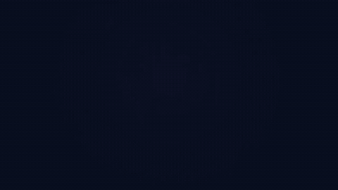
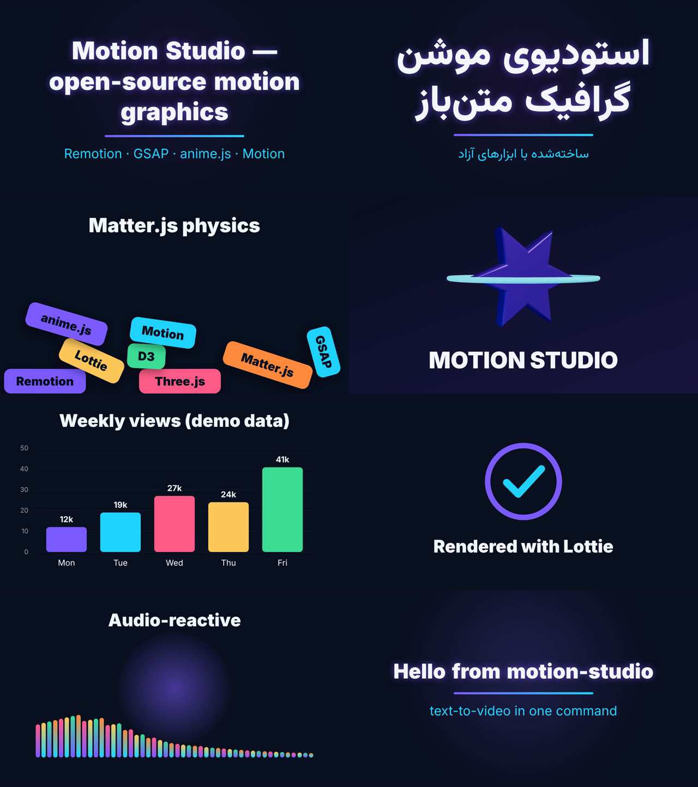
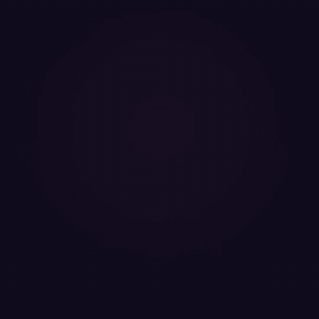

# 🎬 motion-studio

**Open-source motion-graphics studio in code.** Describe a video in a small JSON (or plain-text) file and render an MP4 with one command — titles, physics, 3D, charts, Lottie and audio-reactive scenes, all in one pipeline. Persian / Arabic (RTL) text works out of the box with the Vazirmatn font.

It glues together the best free & open-source motion tools on top of [Remotion](https://www.remotion.dev) (videos written in React), and every library is driven **frame-by-frame** (seeked, not played), so renders are deterministic, parallel and headless-friendly — great for scripts, CI and AI agents.



[فارسی ↓](#-فارسی)

## Gallery





## Tools used

All tools are installed as normal npm dependencies — no third-party source code is copied into this repo.

| Tool | Role in motion-studio | License | Link |
|---|---|---|---|
| **Remotion** (`remotion`, `@remotion/cli`, `/renderer`, `/bundler`, `/lottie`, `/google-fonts`) | Video engine: React components → frames → MP4, headless rendering, Studio preview | [Remotion License](https://github.com/remotion-dev/remotion/blob/main/LICENSE.md) (free for individuals & companies ≤ 3 people; company license above that) | [remotion.dev](https://www.remotion.dev) |
| `@remotion/three`, `@remotion/media-utils` | Three.js canvas bridge; audio FFT / visualisation | MIT | [remotion.dev](https://www.remotion.dev) |
| **GSAP** | Kinetic-typography timeline (paused + seeked per frame) | [GSAP Standard "no charge" License](https://gsap.com/standard-license) (free, incl. commercial; not OSI) | [gsap.com](https://gsap.com) |
| **anime.js** v4 | Easing library (`outBack`, `outExpo`, …) + seeded RNG for deterministic physics | MIT | [animejs.com](https://animejs.com) |
| **Motion** (ex Framer Motion) | Physical spring generator & interpolation (`spring`, `mix`) | MIT | [motion.dev](https://motion.dev) |
| **Three.js** | 3D: extruded logo, lights, materials | MIT | [threejs.org](https://threejs.org) |
| **React Three Fiber** | Declarative React renderer for Three.js | MIT | [r3f.docs.pmnd.rs](https://r3f.docs.pmnd.rs) |
| **Matter.js** | 2D rigid-body physics (pre-simulated at a fixed timestep) | MIT | [brm.io/matter-js](https://brm.io/matter-js/) |
| **Lottie** (`lottie-web`) | Vector animations from JSON (After Effects / LottieFiles / generated in code) | MIT | [airbnb.io/lottie](https://airbnb.io/lottie/) |
| **D3** | Scales, ticks & number formatting for animated charts | ISC | [d3js.org](https://d3js.org) |
| **Zod** | Typed, validated props & spec schema (also powers the Studio props editor) | MIT | [zod.dev](https://zod.dev) |
| **FFmpeg** | Encoding (bundled by Remotion) + synthesising the demo soundtrack | LGPL/GPL | [ffmpeg.org](https://ffmpeg.org) |
| **Vazirmatn** font | Persian/Arabic + Latin typeface (loaded via Google Fonts) | SIL OFL 1.1 | [github.com/rastikerdar/vazirmatn](https://github.com/rastikerdar/vazirmatn) |
| **Inter** font | Latin UI typeface | SIL OFL 1.1 | [rsms.me/inter](https://rsms.me/inter/) |

### Related open-source tools worth knowing (not bundled)
[Motion Canvas](https://motioncanvas.io) (MIT) and [Revideo](https://re.video) (MIT) — alternative code-first video engines · [Theatre.js](https://www.theatrejs.com) (core Apache-2.0, studio AGPL) — visual keyframe editor · [Rive](https://rive.app) runtimes (MIT) — interactive state-machine animations · [Rapier](https://rapier.rs) (Apache-2.0) — high-performance physics · [Manim](https://www.manim.community) (MIT, Python) — math animations · [Tone.js](https://tonejs.github.io) (MIT) — audio synthesis.

## Quick start

Requirements: Node.js 18+ (20 recommended). FFmpeg and a headless Chrome are downloaded automatically by Remotion on first render.

```bash
git clone https://github.com/DanMo88/motion-studio.git
cd motion-studio
npm install
npm run assets                     # synthesise the demo soundtrack (public/demo-beat.mp3)

npm run studio                     # live preview + props editor in the browser
npm run make -- --spec specs/showcase.json        # → out/showcase.mp4
npm run make -- --spec specs/persian.json         # → out/persian.mp4 (1080×1080, RTL)
npm run make -- --spec specs/simple.txt           # plain-text spec
npm run make -- --composition PhysicsDrop --props '{"items":["a","b","c"]}'
npm run render:all                 # every example into out/
```

3D scenes use WebGL; on servers without a GPU the default `--gl swangle` (software rendering) works. On a machine with a GPU try `--gl angle` for speed.

## Writing a spec

### JSON (full control)

```json
{
  "width": 1280, "height": 720, "fps": 30,
  "theme": { "background": "#0b1020", "foreground": "#f5f7ff", "accent": "#7c5cff", "accent2": "#21d4fd" },
  "music": "demo-beat.mp3",
  "scenes": [
    { "type": "title",   "title": "Hello world", "subtitle": "made with code", "duration": 3 },
    { "type": "physics", "items": ["Ideas", "Code", "Video"], "title": "Physics", "duration": 4 },
    { "type": "chart",   "title": "Growth", "unit": "%", "data": [{ "label": "Q1", "value": 30 }, { "label": "Q2", "value": 60 }], "duration": 3.5 },
    { "type": "logo3d",  "label": "MY BRAND", "duration": 3.5 },
    { "type": "badge",   "text": "Done ✓", "duration": 2.5 },
    { "type": "audio",   "audio": "demo-beat.mp3", "title": "Listen", "duration": 5 }
  ]
}
```

`music` / `audio` may be a file in `public/` or an `https://` URL. Use a vertical size like `1080×1920` for Reels/Shorts.

### Plain text (one scene per line)

```text
title: Hello from motion-studio | text-to-video in one command
physics: Ideas | Code | Motion | Video
chart: Sales | Jan=10, Feb=25, Mar=40
logo3d: YOUR BRAND
badge: Shipped!
```

## Compositions

| ID | What it shows | Libraries |
|---|---|---|
| `KineticTitle` / `KineticTitleFa` | Word-by-word kinetic title (keeps Persian letter joining intact) | GSAP, anime.js, Motion |
| `PhysicsDrop` | Labels falling and colliding | Matter.js, anime.js RNG |
| `Logo3D` | Extruded 3D star logo with orbit ring | Three.js, R3F, @remotion/three, Motion |
| `AnimatedChart` | Spring-animated bar chart, RTL aware | D3, Motion |
| `LottieBadge` | Code-generated Lottie check badge | Lottie, anime.js |
| `AudioBars` | Audio-reactive spectrum | @remotion/media-utils |
| `Story` | Any JSON/text spec, scenes back-to-back with fades | all of the above |

## Project layout

```
src/compositions/   one file per scene type (+ Story.tsx, the spec renderer)
src/lib/            fonts (Vazirmatn/RTL detection), easing/spring helpers, theme, Lottie generator
scripts/make.mjs    CLI renderer (bundle → selectComposition → renderMedia)
specs/              example specs (English, Persian, plain text)
```

## Licensing

- The code in this repository is **MIT** (see [LICENSE](LICENSE)).
- Dependencies keep their own licenses (table above). **Remotion is not MIT**: it is free for individuals, non-profits and companies with up to 3 employees; larger for-profit organisations need a [Remotion company license](https://www.remotion.pro/license).
- GSAP is free for commercial use under its own standard license (not an OSI license).

---

## 🇮🇷 فارسی

<div dir="rtl">

**motion-studio** یک استودیوی متن‌باز برای ساخت موشن‌گرافیک با کد است. ویدیو را در یک فایل ساده‌ی JSON یا متنی توصیف می‌کنید و با یک دستور، خروجی MP4 می‌گیرید: تیتر متحرک، صحنه‌ی فیزیک، لوگوی سه‌بعدی، نمودار متحرک، انیمیشن Lottie و میله‌های واکنش‌گرا به صدا.

پایه‌ی پروژه [Remotion](https://www.remotion.dev) است (ساخت ویدیو با React) و بهترین ابزارهای آزاد موشن مثل GSAP، anime.js، Motion، Three.js، Matter.js، Lottie و D3 کنار هم در یک خط تولید قرار گرفته‌اند. همه‌ی انیمیشن‌ها فریم‌به‌فریم محاسبه می‌شوند، پس خروجی همیشه یکسان است و روی سرور بدون مانیتور هم رندر می‌شود. این ویژگی برای اسکریپت‌ها و ایجنت‌های هوش مصنوعی مناسب است.

**پشتیبانی کامل از فارسی:** متن فارسی خودکار تشخیص داده می‌شود، راست‌به‌چپ چیده می‌شود و با فونت وزیرمتن نمایش داده می‌شود. انیمیشن تیتر کلمه‌به‌کلمه است تا اتصال حروف فارسی خراب نشود.

### شروع سریع

</div>

```bash
git clone https://github.com/DanMo88/motion-studio.git
cd motion-studio
npm install
npm run assets
npm run make -- --spec specs/persian.json     # خروجی: out/persian.mp4
npm run studio                                # پیش‌نمایش زنده در مرورگر
```

<div dir="rtl">

### نوشتن سناریو با متن ساده

هر خط یک صحنه است: نوع صحنه، دو نقطه، و متن. بخش‌ها با `|` جدا می‌شوند.

</div>

```text
title: ساخت ویدیو با یک فایل ساده | فارسی و راست‌به‌چپ
physics: سلام | موشن | گرافیک
chart: فروش | فروردین=20, اردیبهشت=45, خرداد=70
badge: آماده شد
```

<div dir="rtl">

### مجوز

کد این مخزن با مجوز MIT منتشر شده است. هر کتابخانه مجوز خودش را دارد (جدول بالا را ببینید). Remotion برای افراد، سازمان‌های غیرانتفاعی و شرکت‌های تا ۳ نفر رایگان است، ولی شرکت‌های بزرگ‌تر باید لایسنس شرکتی آن را بخرند.

</div>
